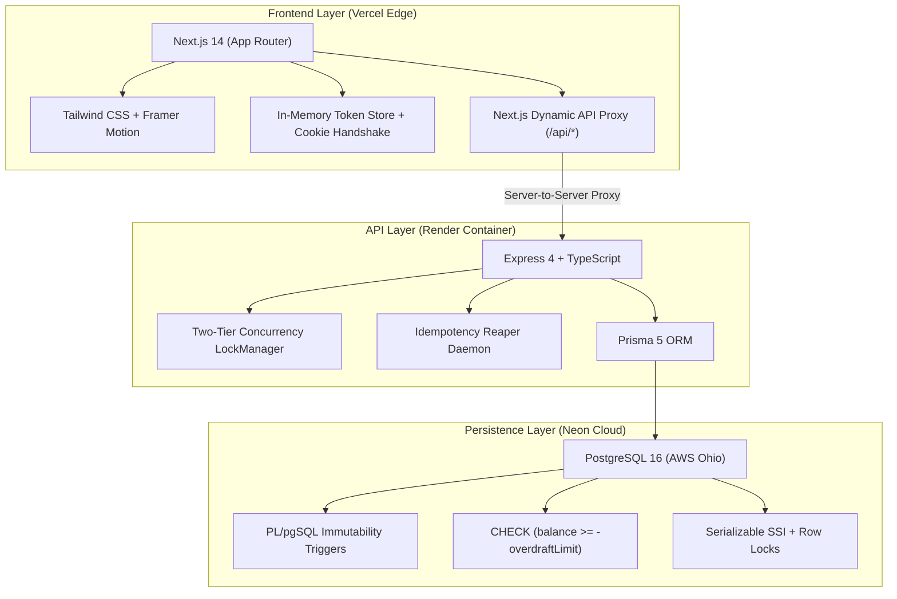
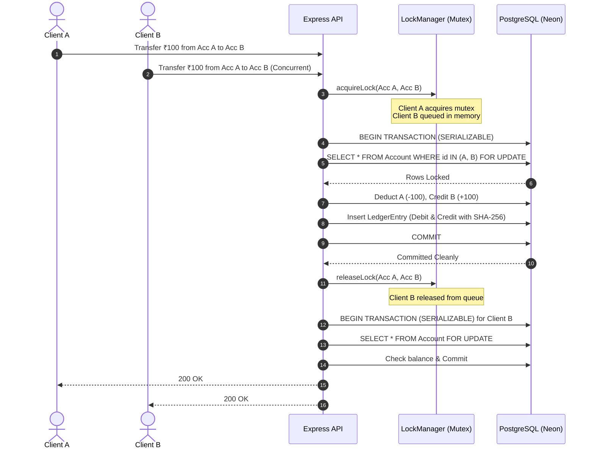
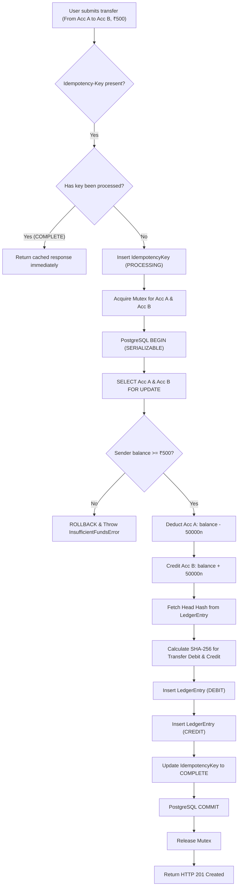

# LedgerLine — Master Architecture & Project Walkthrough

> **Production Deployment Links**  
> * **Frontend Application (Vercel Edge):** [https://ledgerline-tan-beta.vercel.app](https://ledgerline-tan-beta.vercel.app)  
> * **Backend API (Render Web Service):** [https://ledgerline-api-6moj.onrender.com](https://ledgerline-api-6moj.onrender.com)  
> * **Interactive API Documentation:** [https://ledgerline-api-6moj.onrender.com/api-docs/](https://ledgerline-api-6moj.onrender.com/api-docs/)  
> * **Database (Neon Serverless PostgreSQL 16):** AWS US East 2 (Ohio)

---

## 1. Executive Summary & Financial Mission

**LedgerLine** is an enterprise-grade core banking engine and immutable financial ledger. It is engineered around a zero-trust financial philosophy: **money cannot be created or destroyed by software errors, floating-point drift, or concurrent race conditions**.

### The Core Financial Invariants

1. **Conservation of Balance ($\Delta\Sigma = 0$):**  
   Every single internal transfer consists of balanced double-entry adjustments: an exact debit from Account A and an exact credit to Account B. The total system balance is mathematically constant.
2. **Immutability (Append-Only):**  
   Ledger rows are strictly append-only. No `UPDATE` or `DELETE` statements are ever permitted. Database-level PL/pgSQL triggers reject any update or delete operation with an exception.
3. **Cryptographic Tamper-Evidence:**  
   Every ledger entry contains a SHA-256 hash chaining back to the previous entry, forming a cryptographic tamper-evident blockchain from the genesis hash (`0000...0000`) to the current head hash.
4. **Strict Concurrency Safety:**  
   Simultaneous transfer requests hitting the same account are locked via in-memory mutexes and database-level `SELECT ... FOR UPDATE` row locks under PostgreSQL **Serializable Snapshot Isolation (SSI)**.
5. **Zero Floating-Point Drift:**  
   All monetary amounts are represented as integer paise (1 INR = 100 paise) using JavaScript `BigInt` and PostgreSQL `BIGINT`. Floating-point IEEE-754 arithmetic is strictly prohibited.

---

## 2. Technology Stack & Why We Chose Each Tech Over Alternatives



---

### A. Database Engine: PostgreSQL 16 on Neon

#### The Decision:
* **Chosen:** PostgreSQL 16 hosted on Neon Serverless.
* **Alternatives Considered:** MongoDB (NoSQL), MySQL, DynamoDB, CockroachDB.

#### Why PostgreSQL over MongoDB / NoSQL:
* **True ACID & Multi-Row Consistency:** Financial ledger transfers require simultaneous updates across multiple records (`Account` A, `Account` B, and `LedgerEntry`). MongoDB's distributed document model introduces eventual consistency, complex compensation logic, and high risk of phantom reads during partition splits.
* **Database-Level Enforced Invariants:**
  * **CHECK Constraints:** We enforce `CHECK ("balancePence" >= -"overdraftLimit")` directly in PostgreSQL. Even if application code were compromised, PostgreSQL physically rejects any transaction resulting in an illegal negative balance.
  * **PL/pgSQL Mutation Triggers:** We installed a trigger function `prevent_ledger_mutation()` that raises an immediate exception on any `UPDATE` or `DELETE` executed against `"LedgerEntry"`.
* **Serializable Snapshot Isolation (SSI):** PostgreSQL is one of the few databases that provides true SSI without manual table-locking, automatically aborting serialization anomalies (`40001`).

#### Why Neon over Standard Self-Hosted PostgreSQL or AWS RDS:
* **Cloud Persistence & 24/7 Global Availability:** Unlike local instances (`localhost:5432`), Neon runs in AWS Ohio datacenters with automatic failover.
* **Serverless Compute Separation:** Neon separates compute from storage. When the app is idle, compute scales down to zero, eliminating hosting costs while waking up in milliseconds upon incoming HTTP traffic.

---

### B. Monetary Math: Native `BigInt` (Integer Paise)

#### The Decision:
* **Chosen:** Strict Integer Paise arithmetic using JavaScript `BigInt` and PostgreSQL `BIGINT`.
* **Alternatives Considered:** Floating-point numbers (`Number`, `float`, `double`), `Decimal.js`, `bignumber.js`.

#### Why BigInt over IEEE-754 Floats (`Number`):
In standard JavaScript:
```javascript
0.1 + 0.2 // Output: 0.30000000000000004
```
In banking systems, even a micro-cent rounding difference creates audit failures, balance drift, and security vulnerabilities.
* Every balance, deposit, withdrawal, and transfer in LedgerLine is stored in **paise** ($₹1.00 = 100\text{ paise}$).
* $₹10,000.00$ is represented strictly as `1000000n`.
* Math is exact: `1000000n - 50000n = 950000n`. No fractional drift is mathematically possible.
* We installed a global BigInt JSON serializer (`(BigInt.prototype as any).toJSON = function() { return this.toString(); }`) ensuring lossless transmission over HTTP.

---

### C. Backend Engine: Node.js + Express + TypeScript

#### The Decision:
* **Chosen:** Node.js 20+ with Express and TypeScript.
* **Alternatives Considered:** Python (FastAPI/Django), Java (Spring Boot), Go, NestJS.

#### Why TypeScript:
* **Compile-Time Contract Enforcement:** Type-checking catches financial type mismatches (e.g., passing a float instead of a BigInt, or an unvalidated request payload) during compilation rather than in production.
* **Prisma Integration:** Generates 100% type-safe database queries mapped directly to database schema enums (`Role`, `EntryType`, `EntryStatus`).

#### Why Express over NestJS / Fastify:
* **Minimalist Architecture:** Avoids heavy dependency injection abstraction layers. Every middleware (authentication, rate-limiting, CORS, request tracing, and graceful shutdown) is transparent, inspectable, and zero-magic.
* **Deterministic Transaction Lifecycles:** Allows surgical control over PostgreSQL connection pools, transaction timeouts, and in-memory lock releases.

---

### D. Authentication & Security: Hybrid In-Memory JWT + HttpOnly Refresh Cookie

#### The Decision:
* **Chosen:** In-memory access token (short-lived, 15 min) + `HttpOnly`, `SameSite=Lax`, `Secure` refresh cookie (long-lived, 7 days) with silent refresh retry.
* **Alternatives Considered:** LocalStorage JWT, Pure Session Cookies, OAuth2/Auth0.

#### Why In-Memory over LocalStorage:
* **Complete XSS Immunity:** `localStorage` is completely readable by any JavaScript running in the browser. If a third-party script or dependency suffers a Cross-Site Scripting (XSS) vulnerability, all tokens in `localStorage` can be stolen immediately.
* In LedgerLine, access tokens reside exclusively in **in-memory closure variables**. JavaScript cannot read them from the DOM or storage.
* Refresh tokens are stored in an **`HttpOnly` cookie**, meaning client-side JavaScript has zero programmatic access to the refresh token.

#### Silent Refresh Handshake:
When an access token expires (or upon browser refresh):
1. `fetchWithAuth` catches a `401 Unauthorized`.
2. The client fires `POST /api/auth/refresh` sending the `HttpOnly` cookie.
3. The server validates the active refresh token in PostgreSQL, generates a new token pair, and returns a fresh access token.
4. The client retries the original request transparently — the user never experiences session interruption.

---

### E. Concurrency Architecture: Two-Tier Concurrency Control

#### The Decision:
* **Chosen:** Tier 1 In-Memory Mutex Lock (`LockManager`) + Tier 2 PostgreSQL `SELECT ... FOR UPDATE` under Serializable Isolation with exponential backoff retries.
* **Alternatives Considered:** Optimistic locking with version columns alone, Distributed Redis locks (Redlock).



#### Why Optimistic Locking Alone is Insufficient:
Optimistic locking (`WHERE version = expectedVersion`) aborts on concurrent updates. Under heavy load (e.g. 50 concurrent transactions hitting one account in the Stress Lab), 90% of requests would fail and require client retries.
* **Tier 1 (In-Memory Mutex):** Serializes requests targeting the same account pairs before they hit database connection pool threads.
* **Tier 2 (PostgreSQL Row Locks):** Guarantees that across multiple processes or distributed pods, transactions wait for lock release rather than reading stale balances.
* **Serialization Retry Loop:** If PostgreSQL detects a serialization conflict (`code: 40001`), the transaction automatically rolls back, waits with jittered exponential backoff, and retries up to 3 times before returning an error.

---

### F. Frontend Architecture: Next.js 14 (App Router) + Tailwind CSS

#### The Decision:
* **Chosen:** Next.js 14 App Router deployed to Vercel Edge.
* **Alternatives Considered:** Single Page App (Vite/React), Remix, SvelteKit.

#### Why Next.js 14:
* **Dynamic API Rewrites (`next.config.js`):**  
  The frontend proxies `/api/*` server-to-server to the Render backend:
  ```javascript
  { source: '/api/:path*', destination: `${apiUrl}/:path*` }
  ```
  This eliminates cross-origin cookie restrictions! The browser thinks it is communicating with the same origin (`https://ledgerline-tan-beta.vercel.app`), enabling smooth cookie storage even in Safari and Chrome with strict third-party cookie blocking.
* **Minimal Enterprise Design Tokens:** Tailored around Stripe and Linear design aesthetics: `#F5F8FC` canvas, `#078BCB` action blue, `#172B45` slate typography, 14px card radii, and tabular figures (`font-mono`) for numerical financial alignment.

---

## 3. End-to-End Walkthrough of LedgerLine

---

### Walkthrough 1: Authentication & Role-Based Access Control (RBAC)

LedgerLine implements strict Role-Based Access Control with 3 distinct organizational roles:

| Role | Permitted Actions | Restricted Actions |
| :--- | :--- | :--- |
| **`HOLDER`** | View own accounts, view personal statements, execute outgoing transfers. | Cannot view other users' accounts, cannot access Admin Audit Trail, cannot run Stress Lab. |
| **`ADMIN`** | View all system accounts, execute transfers, view audit logs, trigger live concurrency Stress Lab. | Cannot delete or mutate ledger entries (blocked by DB trigger). |
| **`AUDITOR`** | Read-only global access to all accounts, full ledger audit verification, statement generation. | Cannot execute transfers, cannot initiate stress tests (strictly non-mutating read access). |

#### The Login Experience:
1. Navigate to [`/login`](https://ledgerline-tan-beta.vercel.app/login).
2. The user is presented with the minimal single-column card.
3. Three one-click demo pills (**Holder**, **Admin**, **Auditor**) prefill demo credentials.
4. Upon clicking **Sign In**, the API verifies password hash using `bcrypt.compare`, creates an active refresh token in PostgreSQL, dispatches the `HttpOnly` cookie, and sets the in-memory access token.
5. The user is redirected to `/dashboard`.

---

### Walkthrough 2: The Core Banking Transfer Engine



#### Code Defense Highlights:
* **The Double-Reversal Race Bug (T-21):**  
  In [`transferService.ts`](file:///c:/Users/premn/LedgerLine/apps/api/src/services/transferService.ts), the check for existing reversal entries is executed **inside the `$transaction` block under row locks**:
  ```typescript
  const existingReversal = await tx.ledgerEntry.findFirst({
    where: { type: EntryType.ADJUSTMENT, note: { contains: `Reversal of entry ${entryId}` } },
  });
  if (existingReversal) throw new ReversalAlreadyProcessedError(...);
  ```
  If two reversal requests targeting the same entry arrive simultaneously with different idempotency keys, the second transaction is forced to wait on row locks, detects the newly committed reversal record, and immediately throws without creating duplicate compensating credits.

---

### Walkthrough 3: Cryptographic Hash Chaining & Audit Trail

Every transaction committed to LedgerLine is sealed with a cryptographic hash.

#### The Block Formulation:
$$\text{Current Hash} = \text{SHA256}\Big(\text{Previous Hash} \parallel \text{Entry ID} \parallel \text{Type} \parallel \text{Amount} \parallel \text{Balance} \parallel \text{Timestamp}\Big)$$

1. The first system entry (Genesis) links to `0000000000000000000000000000000000000000000000000000000000000000`.
2. Every subsequent entry incorporates the SHA-256 hash of its predecessor.
3. If an attacker with direct SQL access attempts to tamper with a historic transaction amount, the hash of that block changes. 
4. Every subsequent block's hash immediately becomes invalid, breaking the chain.

#### How to Verify:
* Navigate to **Audit Trail** (`/admin/audit`) as an Administrator or Auditor.
* The system evaluates every block from entry $1$ to $N$.
* If all cryptographic hashes match, the interface displays:
  $$\text{Integrity Verified: } \text{102 of 102 blocks intact. Zero discrepancies.}$$

---

### Walkthrough 4: Mobile-Responsive Admin Stress Lab

The **Stress Lab** (`/admin/stress-lab`) is an administrative testing facility designed to demonstrate database concurrency under extreme load.

```text
[ Stress Lab Configuration ]
• Concurrency: 5, 10, or 25 Simultaneous Requests
• Amount per Transfer: ₹10.00
• Execution Model: PostgreSQL Serializable SSI + FOR UPDATE Locks
• Invariant Monitored: Total System Balance Delta (ΔΣ = 0)
```

#### What Happens When You Click "Run Concurrency Simulation":
1. The frontend dispatches a burst of 25 simultaneous asynchronous HTTP requests to `POST /api/admin/simulate-stress`.
2. The backend fires concurrent database transactions attempting to debit and credit the accounts at the exact same millisecond.
3. PostgreSQL SSI detects concurrent write attempts on the same rows.
4. The transaction retry mechanism resolves serialization deadlocks gracefully.
5. **The Result:** All 25 transfers execute, 50 ledger entries are written, the SHA-256 chain advances by 50 links, and the system verifies that total system balance changed by exactly **₹0.00** ($\Delta\Sigma = 0$).

---

### Walkthrough 5: Idempotency & The Background Reaper Daemon

Financial networks are inherently unreliable. When mobile connections drop, clients often resend payment requests. Without idempotency, this results in double-charging the customer.

#### The LedgerLine Solution:
1. Every state-modifying request requires an `Idempotency-Key` header (UUID v4).
2. The key is scoped to the authenticated `userId`.
3. If the request is received for the first time:
   * A record is created with status `PROCESSING`.
   * The transaction completes, and the status updates to `COMPLETE` with the serialized HTTP response body.
4. If a duplicate request arrives while processing:
   * Returns `409 Conflict: Request currently processing`.
5. If a duplicate request arrives after completion:
   * The server returns the cached response with header `X-Cache: HIT`, without executing any database balance updates.
6. **The Reaper Daemon:**  
   Every 60 minutes, a background cron daemon ([`idempotencyReaper.ts`](file:///c:/Users/premn/LedgerLine/apps/api/src/services/idempotencyReaper.ts)) purges idempotency keys older than 24 hours, ensuring the database table remains lean and fast.

---

## 4. Production Runbook & Live Verification Cheatsheet

### Live Test Credentials

| Role | Email | Password | Intended Test View |
| :--- | :--- | :--- | :--- |
| **HOLDER** | `holder@ledgerline.dev` | `Holder1234!` | Account A balances, send transfer, view personal history. |
| **ADMIN** | `admin@ledgerline.dev` | `Admin1234!` | Full system dashboard, Audit Trail, Concurrency Stress Lab. |
| **AUDITOR** | `auditor@ledgerline.dev` | `Audit1234!` | Global read-only reconciliation, cryptographic chain verification. |

### Direct CLI Verification Commands

You can verify the live production API directly from any command line:

```bash
# 1. Check live database connectivity
curl https://ledgerline-api-6moj.onrender.com/health

# 2. Test login through the Vercel edge proxy
curl -X POST https://ledgerline-tan-beta.vercel.app/api/auth/login \
  -H "Content-Type: application/json" \
  -d '{"email":"holder@ledgerline.dev","password":"Holder1234!"}'

# 3. View interactive Swagger UI documentation
open https://ledgerline-api-6moj.onrender.com/api-docs/
```

---

## 5. Architectural Summary Table

| Requirement | Industry Risk | LedgerLine Implementation |
| :--- | :--- | :--- |
| **Balance Conservation** | Inconsistent ledger writes | Balanced double-entry pairs, $\Delta\Sigma = 0$ mathematical invariant. |
| **Floating-Point Drift** | Micro-cent calculation leaks | Strict `BigInt` integer paise arithmetic across all layers. |
| **Negative Balances** | Overdraft exploits | Database-level `CHECK ("balancePence" >= -"overdraftLimit")`. |
| **Ledger Tampering** | Rogue DBA modifying amounts | PL/pgSQL `prevent_ledger_mutation` trigger + SHA-256 blockchain. |
| **Double-Spending** | Network drop & retry | Scoped `Idempotency-Key` tracking + 24hr Reaper Daemon. |
| **Race Conditions** | Concurrent requests overdrawing | Tier 1 Mutex + PostgreSQL `SELECT ... FOR UPDATE` row locks. |
| **Credential Theft** | XSS attacks stealing tokens | In-memory token storage + `HttpOnly` `SameSite=Lax` cookies. |
| **Zero Downtime Hosting** | Single-point server crashes | Vercel Edge CDN + Render Cloud Node Container + Neon Serverless DB. |
